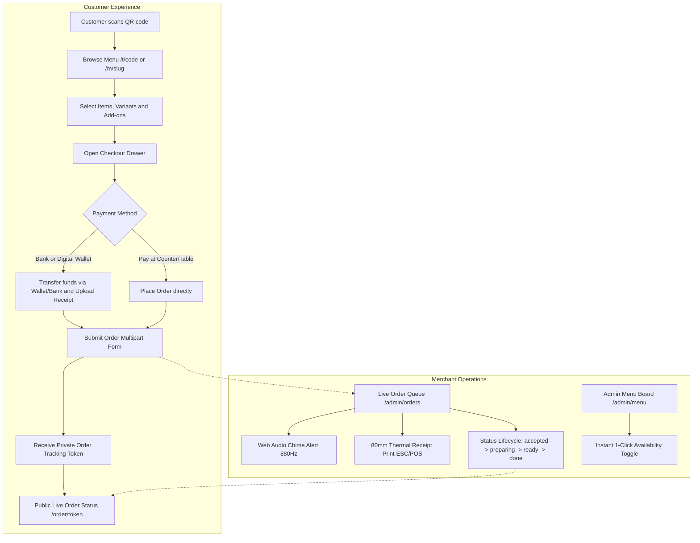

# FineDine System Map & Architectural Blueprint

> **Status:** Active Reference & Repository Map  
> **Application:** FineDine QR Orders  
> **Document Purpose:** Complete, exhaustive structural and architectural map of the FineDine codebase. Contains all technology choices, system design patterns, database schemas, directory breakdowns, API contracts, security controls, and operational workflows.

---

## 1. Executive Overview & Core Product Model

FineDine is a multi-tenant, high-performance web application designed for hospitality and counter-service venues (restaurants, cafes, groceries, bakeries, and ice cream shops). It eliminates friction and third-party commission fees by enabling direct customer QR ordering with manual bank/wallet transfer verification or pay-at-table/counter options, coupled with a real-time merchant operations dashboard.

### Core Product Workflows



1. **Scan & Browse:** Customers scan a physical QR code (resolving via `/t/[code]` or `/m/[slug]`) to browse localized menus (English/Arabic) with full variant and add-on support.
2. **Order & Payment Verification:** Orders require upfront payment method selection. For digital wallets (e.g., Jawwal Pay) and bank transfers, customers provide their sender phone number, transfer reference ID, and upload an image receipt. For cash/card, customers select pay-at-table/counter.
3. **Receipt Validation & Storage:** Uploaded receipts are verified via magic byte signatures (JPEG, PNG, WebP), assigned SHA-256 checksums, and stored securely in `.uploads/receipts/`.
4. **Order Tracking:** Customers receive an opaque tracking token (`ord_<base64url>`) providing real-time status updates (`confirmed` $\rightarrow$ `accepted` $\rightarrow$ `preparing` $\rightarrow$ `done`) without exposing sensitive business data.
5. **Kitchen & Staff Operations:** Staff manage orders via `/admin/orders` featuring an auto-refreshing queue (12s polling), synthetic audio chime alerts on incoming tickets, status updates with audit logging, and 80mm thermal receipt printing.

---

## 2. Technology Stack & Dependencies

### Core Framework & Runtime
| Layer | Technology | Version | Purpose & Rationale |
| :--- | :--- | :--- | :--- |
| **Framework** | [Next.js](https://nextjs.org) | `16.4.0` | App Router architecture, Server Components, standalone Docker build capability, Route Handlers. |
| **Runtime** | [Node.js](https://nodejs.org) | `>= 22` | Modern ES Module runtime (`"type": "module"` in `package.json`), native fetch, Node crypto. |
| **Language** | [TypeScript](https://www.typescriptlang.org) | `5.9.3` | End-to-end type safety across DB schemas, API route payloads, and React components. |
| **UI Library** | [React](https://react.dev) | `19.3.0` | React 19 concurrent features, `useTransition` for non-blocking UI refreshes. |
| **DOM Engine** | React DOM | `19.3.0` | Client hydration and rendering. |

### Database & ORM Layer
| Technology | Package | Version | Purpose |
| :--- | :--- | :--- | :--- |
| **ORM** | `drizzle-orm` | `0.45.4` | Lightweight, high-speed TypeScript ORM with PostgreSQL dialect (`pg-core`). |
| **Migration Kit** | `drizzle-kit` | `0.31.11` | Schema management and migrations. Configured in [drizzle.config.ts](file:///c:/Users/hp/Documents/FineDine/drizzle.config.ts). |
| **Embedded DB** | `@electric-sql/pglite` | `0.5.9` | WASM-powered real PostgreSQL engine running locally in `./.pgdata` or `memory://`. Zero external service dependencies on Windows. |
| **Production Driver** | `postgres` (postgres.js) | `3.4.9` | High-throughput PostgreSQL driver used when `DATABASE_URL` is configured. |

### Authentication, Security & Cryptography
| Package | Version | Purpose |
| :--- | :--- | :--- |
| `jose` | `6.1.0` | High-performance JWT issuance and verification (HS256) for HTTP-only session cookies. |
| `bcryptjs` | `3.0.2` | Secure password hashing (12 salt rounds) for administrative accounts. |
| `zod` | `4.1.12` | Runtime schema validation for order submissions, auth credentials, and admin mutations. |
| `node:crypto` | Native | SHA-256 hashing for QR tokens and tracking tokens; secure random UUID and token generation. |

### Utilities & Media
| Package | Version | Purpose |
| :--- | :--- | :--- |
| `qrcode` | `1.5.4` | Server-side SVG QR code generation rendered dynamically via Route Handlers. |
| `tsx` | `4.23.15` | Fast TypeScript execution engine used for running integration test scripts. |
| Google Fonts | Remote / Next Font | Variable typography: `Plus_Jakarta_Sans` (Latin) and `Noto_Naskh_Arabic` (Arabic). |

---

## 3. Architecture & Core Design Patterns

```
                                      +-----------------------------+
                                      |     Client / Browser        |
                                      +--------------+--------------+
                                                     |
                                   HTTP / Cookies    | Same-Origin APIs
                                                     v
                         +----------------------------------------------------+
                         |             Next.js 16 App Router                  |
                         |  +----------------------------------------------+  |
                         |  | Proxy / Middleware (proxy.ts)                |  |
                         |  | - Strict CSP, Anti-Clickjacking (DENY)       |  |
                         |  | - X-Content-Type-Options, X-Request-Id       |  |
                         |  +----------------------+-----------------------+  |
                         |                         |                          |
                         |        +----------------+----------------+         |
                         |        |                                 |         |
                         |        v                                 v         |
                         |  [Public Routes]                 [Admin Routes]    |
                         |  - /m/[slug]                     - /admin          |
                         |  - /t/[code]                    - /admin/orders   |
                         |  - /order/[token]                - /admin/menu     |
                         |  - /api/public/orders            - /api/admin/*    |
                         +--------+---------------------------------+---------+
                                  |                                 |
                                  +----------------+----------------+
                                                   |
                                                   v
                                     +---------------------------+
                                     |  Service Layer (store.ts) |
                                     |  - Tenant Scoping Guard   |
                                     |  - Order Calculation      |
                                     |  - Magic-Byte Validator   |
                                     |  - Audit Log Emitter      |
                                     +-------------+-------------+
                                                   |
                                                   v
                                     +---------------------------+
                                     |      Database Client      |
                                     |    (src/db/client.ts)     |
                                     +-------------+-------------+
                                                   |
                       +---------------------------+---------------------------+
                       |                                                       |
                       v                                                       v
        +-----------------------------+                         +-----------------------------+
        |     Local / Dev Mode        |                         |       Production Mode       |
        |   @electric-sql/pglite      |                         |      Managed PostgreSQL     |
        |    (./.pgdata directory)    |                         |    (DATABASE_URL connection)|
        +-----------------------------+                         +-----------------------------+
```

### 1. Dual-Mode Database Architecture
FineDine abstracts PostgreSQL connectivity in [src/db/client.ts](file:///c:/Users/hp/Documents/FineDine/src/db/client.ts):
- **Development & Local Mode:** When `DATABASE_URL` is omitted, the app spins up `@electric-sql/pglite` using `./.pgdata` (or `memory://` during automated tests). This grants full PostgreSQL compliance (JSONB, UUID, PG enums, indexes) without needing Docker or native PostgreSQL services installed on the developer's OS.
- **Production Mode:** When `DATABASE_URL` starts with `postgres://` or `postgresql://`, the system connects via `postgres.js` with connection pooling (`max: 10, prepare: false`).
- **Singleton Pattern:** The database handle is cached on `globalThis.fineDineDb` to prevent socket leaks during Next.js Hot Module Reloading (HMR).

### 2. Multi-Tenant Isolation
All business entities (`branches`, `categories`, `menu_items`, `payment_methods`, `qr_codes`, `orders`, `audit_logs`) are strictly bound to a `businessId` foreign key with cascade deletion.
- Admin APIs authenticate the tenant via session JWT (`session.businessId`).
- Every query, update, or status mutation enforces `and(eq(orders.id, orderId), eq(orders.businessId, session.businessId))`. Cross-tenant mutations are rejected at the DB query level.

### 3. Opaque Tokenized QR & Order Progress System
- **QR Codes:** Printed QR codes point to `/t/[code]`. In the database, only the SHA-256 hash (`tokenHash`) is stored. This prevents brute-force token generation or URL guessing from exposing internal IDs.
- **Customer Tracking:** When an order is placed, a cryptographic token (`ord_<base64url>`) is minted and returned to the customer. Its SHA-256 hash is saved in `orders.public_token_hash`. The public tracking route (`/order/[token]` and `/api/public/orders/[token]`) only yields non-sensitive progress milestones (`confirmed`, `accepted`, `preparing`, `done`, `cancelled`).

### 4. File Upload Verification (Magic Bytes)
In [app/api/public/orders/route.ts](file:///c:/Users/hp/Documents/FineDine/app/api/public/orders/route.ts), receipt uploads are guarded against malicious files:
- Maximum file size: `5MB`.
- Allowed MIME types: `image/jpeg`, `image/png`, `image/webp`.
- **Magic Byte Signature Inspection:** Reads initial buffer bytes:
  - JPEG: `FF D8 FF`
  - PNG: `89 50 4E 47 0D 0A 1A 0A`
  - WebP: `RIFF....WEBP`
- Generates a SHA-256 checksum and saves to `.uploads/receipts/[uuid].[ext]`.

### 5. Web Audio Chime & 80mm ESC/POS Thermal Printing
- In [components/OrdersBoard.tsx](file:///c:/Users/hp/Documents/FineDine/components/OrdersBoard.tsx), when polling detects a new order ID, it uses the Web Audio API (`AudioContext` / `webkitAudioContext`) to generate an 880Hz sine tone chime with exponential gain ramp.
- Thermal printing uses standard CSS `@media print` targeting an 80mm paper width (`@page { size: 80mm auto; margin: 4mm; }`), isolating only the active ticket (`.order-card.print-active`).

---

## 4. Comprehensive Directory & File Structure Map

```
c:/Users/hp/Documents/FineDine/
│
├── .dockerignore                 # Excludes node_modules, git, and local data from Docker images
├── .env                          # Local active environment variables
├── .env.example                  # Template environment variables (AUTH_SECRET, PGLITE_DATA_DIR, DATABASE_URL)
├── .gitignore                    # Git exclusions (.next, .pgdata, .uploads, node_modules)
├── Dockerfile                    # Multi-stage production container build (deps -> builder -> runner)
├── README.md                     # High-level product overview and setup instructions
├── SYSTEM_MAP.md                 # THIS FILE - Master architectural blueprint and component map
├── drizzle.config.ts             # Drizzle Kit configuration pointing to schema and credentials
├── eslint.config.mjs             # ESLint 9 configuration with typescript-eslint
├── next-env.d.ts                 # Next.js TypeScript ambient declarations
├── next.config.mjs               # Next.js configuration (security headers, turbopack, image domains)
├── package.json                  # Project manifest, npm scripts, dependencies, overrides
├── package-lock.json             # Exact dependency lockfile
├── proxy.ts                      # Edge proxy / middleware setting Content-Security-Policy & Request ID
├── tsconfig.json                 # TypeScript compiler options and '@/*' path mappings
│
├── app/                          # Next.js App Router Root
│   ├── globals.css               # Design system tokens, layouts, responsive rules, thermal print CSS
│   ├── layout.tsx                # Root layout with font loading (Plus Jakarta Sans & Noto Naskh Arabic)
│   ├── page.tsx                  # Marketing / Landing page with demo links and product overview
│   │
│   ├── admin/                    # Protected Merchant Portal (requires auth session)
│   │   ├── layout.tsx            # Admin layout with sidebar navigation and session protection
│   │   ├── page.tsx              # Operations dashboard: revenue metrics, order count, dynamic QR preview
│   │   ├── menu/                 # Menu management
│   │   │   └── page.tsx          # Menu operations page rendering AdminMenuBoard
│   │   └── orders/               # Real-time order queue
│   │       └── page.tsx          # Orders page rendering OrdersBoard
│   │
│   ├── api/                      # Backend API Route Handlers
│   │   ├── admin/                # Admin-only endpoints (session required)
│   │   │   ├── items/
│   │   │   │   └── [id]/
│   │   │   │       └── route.ts  # PATCH: Toggle menu item availability or update pricing
│   │   │   └── orders/
│   │   │       └── [id]/
│   │   │           └── route.ts  # PATCH: Transition order lifecycle status + audit log
│   │   ├── auth/                 # Authentication endpoints
│   │   │   ├── login/
│   │   │   │   └── route.ts      # POST: Rate-limited email/password sign-in issuing JWT cookie
│   │   │   └── logout/
│   │   │       └── route.ts      # POST: Clear session cookie
│   │   ├── health/
│   │   │   └── route.ts          # GET: Health check verifying database responsiveness
│   │   ├── orders/
│   │   │   └── route.ts          # POST: Direct JSON order submission endpoint (legacy/internal)
│   │   ├── public/               # Customer public endpoints
│   │   │   └── orders/
│   │   │       ├── route.ts      # POST: Multipart form order submission with receipt file validation
│   │   │       └── [token]/
│   │   │           └── route.ts  # GET: Opaque token lookup for public order progress
│   │   └── qr/
│   │       └── [slug]/
│   │           └── route.ts      # GET: Dynamic SVG QR code generator for branch menu
│   │
│   ├── login/
│   │   └── page.tsx              # Admin sign-in interface with demo credentials autofill
│   ├── m/
│   │   └── [slug]/
│   │       └── page.tsx          # Direct public menu page (/m/demo-cafe)
│   ├── q/
│   │   └── [token]/
│   │       └── page.tsx          # QR-scanned menu landing page resolving token to branch
│   └── order/
│       └── [token]/
│           └── page.tsx          # Customer order tracking progress screen with 4-step stepper
│
├── components/                   # Reusable React UI Components
│   ├── AdminMenuBoard.tsx        # Client table for admin menu list with 1-click availability toggles
│   ├── MenuClient.tsx            # Customer menu client: i18n, search, category tabs, cart, customization
│   ├── OrderProgressClient.tsx   # Auto-polling progress stepper component (8-second interval)
│   ├── OrdersBoard.tsx           # Live order queue: 12s polling, 880Hz audio chime, 80mm ticket printing
│   └── menu/                     # Customer Menu Sub-components
│       ├── CheckoutDrawer.tsx    # Slide-over checkout drawer: form fields, payment picker, receipt upload
│       └── ProductCard.tsx       # Product grid card with image, price, labels, and customize trigger
│
├── lib/                          # Core Utilities & Helpers
│   ├── auth.ts                   # JWT session management via Jose, bcrypt verification, cookie helpers
│   ├── format.ts                 # Currency formatter (formatMoney for ILS) and search string sanitizer
│   ├── rate-limit.ts             # Fixed-window rate limiter: in memory on PGlite, a shared counter in the `rate_limits` table on Postgres
│   └── store.ts                  # Re-export proxy pointing to src/server/store
│
├── src/                          # Server Logic & Persistence Architecture
│   ├── db/
│   │   ├── client.ts             # Database connection factory (PGlite local vs Postgres production)
│   │   ├── init.ts               # Runs ./drizzle migrations on PGlite; on Postgres only checks they were applied
│   │   └── schema.ts             # Drizzle ORM pgTable definitions, PG enums, TypeScript types
│   └── server/
│       └── store.ts              # Business domain service: seed data, order calculations, queries, audit
│
├── scripts/                      # Maintenance & CI/CD Scripts
│   ├── integration.ts            # End-to-end integration test (in-memory DB, multi-tenant isolation, flow)
│   └── reset-db.mjs              # Node script to delete .pgdata directory for fresh database rebuild
│
└── types/                        # Shared TypeScript Interface Definitions
    └── menu.ts                   # ProductView, CategoryView, VariantView, AddOnView, CartItemView
```

---

## 5. Database Schema & Data Models

All relational tables are defined in [src/db/schema.ts](file:///c:/Users/hp/Documents/FineDine/src/db/schema.ts) using Drizzle ORM's `pg-core` module:

### PostgreSQL Enums
- **`user_role`**: `['owner', 'manager', 'staff']`
- **`order_status`**: `['new', 'accepted', 'preparing', 'ready', 'completed', 'cancelled']`

### Table Definitions & Field Mapping

#### 1. `businesses`
Multi-tenant root organization.
- `id` (`uuid`, PK)
- `name` (`text`, NOT NULL)
- `slug` (`text`, NOT NULL, UNIQUE)
- `created_at` (`timestamptz`, default now())
- `updated_at` (`timestamptz`, default now())

#### 2. `branches`
Physical or virtual storefront locations owned by a business.
- `id` (`uuid`, PK)
- `business_id` (`uuid`, FK $\rightarrow$ `businesses.id` ON DELETE CASCADE)
- `name` (`text`, NOT NULL)
- `slug` (`text`, NOT NULL, UNIQUE)
- `address` (`text`, NOT NULL)
- `phone` (`text`, NOT NULL)
- `currency` (`text`, default `'ILS'`)
- `is_open` (`boolean`, default `true`)
- `created_at` / `updated_at` (`timestamptz`)
- *Index:* `branches_business_id_idx` on `business_id`

#### 3. `users`
Administrative staff and owners.
- `id` (`uuid`, PK)
- `business_id` (`uuid`, FK $\rightarrow$ `businesses.id` ON DELETE CASCADE)
- `email` (`text`, NOT NULL, UNIQUE)
- `name` (`text`, NOT NULL)
- `password_hash` (`text`, NOT NULL - bcrypt)
- `role` (`user_role`, default `'staff'`)
- `created_at` / `updated_at` (`timestamptz`)
- *Index:* `users_business_id_idx` on `business_id`

#### 4. `categories`
Product groupings within a branch.
- `id` (`uuid`, PK)
- `business_id` (`uuid`, FK $\rightarrow$ `businesses.id` ON DELETE CASCADE)
- `branch_id` (`uuid`, FK $\rightarrow$ `branches.id` ON DELETE CASCADE)
- `name_en` (`text`, NOT NULL)
- `name_ar` (`text`, NOT NULL)
- `sort_order` (`integer`, default `0`)
- `is_active` (`boolean`, default `true`)
- *Indexes:* `categories_business_id_idx`, `categories_branch_sort_idx` (`branch_id, sort_order`)

#### 5. `menu_items`
Individual products on the menu.
- `id` (`uuid`, PK)
- `business_id` / `branch_id` / `category_id` (FKs ON DELETE CASCADE)
- `name_en` / `name_ar` (`text`, NOT NULL)
- `description` (`text`, NOT NULL)
- `image_url` (`text`, NOT NULL)
- `price_cents` (`integer`, NOT NULL)
- `is_available` (`boolean`, default `true`)
- `is_featured` (`boolean`, default `false`)
- `labels` (`text`, default `''`) - comma separated (e.g. `"popular,cold"`)
- `sort_order` (`integer`, default `0`)
- *Indexes:* `menu_items_business_id_idx`, `menu_items_branch_category_sort_idx`

#### 6. `item_variants`
Size or preparation options (e.g., "Regular", "Large").
- `id` (`uuid`, PK)
- `menu_item_id` (`uuid`, FK $\rightarrow$ `menu_items.id` ON DELETE CASCADE)
- `name` (`text`, NOT NULL)
- `price_delta` (`integer`, default `0`)
- `sort_order` (`integer`, default `0`)
- *Index:* `item_variants_menu_item_id_idx`

#### 7. `item_add_ons`
Optional extras (e.g., "Extra shot", "Oat milk").
- `id` (`uuid`, PK)
- `menu_item_id` (`uuid`, FK $\rightarrow$ `menu_items.id` ON DELETE CASCADE)
- `name` (`text`, NOT NULL)
- `price_cents` (`integer`, default `0`)
- `sort_order` (`integer`, default `0`)
- *Index:* `item_add_ons_menu_item_id_idx`

#### 8. `payment_methods`
Accepted bank transfer accounts, digital wallets, or cash options.
- `id` (`uuid`, PK)
- `business_id` / `branch_id` (FKs ON DELETE CASCADE)
- `label` (`text`, NOT NULL)
- `type` (`text`, NOT NULL) - e.g. `'cash_or_card'`, `'digital_wallet'`, `'bank'`, `'other'`
- `account_name` (`text`, NOT NULL)
- `phone` (`text`, NOT NULL)
- `details` (`text`, NOT NULL) - instructions for the customer
- `is_default` (`boolean`, default `false`)
- `is_active` (`boolean`, default `true`)
- *Indexes:* `payment_methods_business_id_idx`, `payment_methods_branch_id_idx`

#### 9. `qr_codes`
Dynamic QR code registry for branch or table-specific scanning.
- `id` (`uuid`, PK)
- `business_id` / `branch_id` (FKs ON DELETE CASCADE)
- `token_hash` (`text`, NOT NULL, UNIQUE) - SHA-256 of plain token
- `label` (`text`, NOT NULL)
- `table_label` (`text`, optional)
- `kind` (`text`, default `'branch'`)
- `is_active` (`boolean`, default `true`)
- `created_at` / `updated_at` (`timestamptz`)
- *Indexes:* `qr_codes_business_id_idx`, `qr_codes_branch_id_idx`

#### 10. `orders`
Master order record.
- `id` (`uuid`, PK)
- `business_id` / `branch_id` (FKs ON DELETE CASCADE)
- `order_number` (`integer`, NOT NULL) - branch-scoped sequential number starting at 1001
- `status` (`order_status`, default `'new'`)
- `public_token_hash` (`text`, NOT NULL, UNIQUE) - SHA-256 of private customer tracking token
- `payment_status` (`text`, default `'pending_review'`)
- `qr_code_id` (`uuid`, FK $\rightarrow$ `qr_codes.id`, nullable)
- `first_name` / `last_name` (`text`, NOT NULL)
- `customer_name` (`text`, NOT NULL)
- `customer_phone` (`text`, NOT NULL)
- `table_label` (`text`, nullable)
- `note` (`text`, nullable)
- `total_cents` (`integer`, NOT NULL)
- `payment_method_id` (`uuid`, FK $\rightarrow$ `payment_methods.id`)
- `payment_method_label` (`text`, NOT NULL)
- `transfer_from_phone` (`text`, NOT NULL)
- `transfer_reference` (`text`, NOT NULL)
- `receipt_storage_key` (`text`, nullable)
- `receipt_original_name` (`text`, nullable)
- `receipt_mime_type` (`text`, nullable)
- `receipt_size` (`integer`, nullable)
- `receipt_checksum` (`text`, nullable)
- `line_items` (`jsonb` typed as `OrderLineItem[]`, NOT NULL)
- `created_at` / `updated_at` (`timestamptz`)
- *Indexes:* `orders_business_id_idx`, `orders_branch_status_idx`, UNIQUE(`branch_id, order_number`)

#### 11. `audit_logs`
Immutable audit trail for compliance, traceability, and operations.
- `id` (`uuid`, PK)
- `business_id` / `branch_id` (FKs ON DELETE CASCADE)
- `actor_user_id` (`uuid`, FK $\rightarrow$ `users.id`, nullable)
- `action` (`text`, NOT NULL) - e.g. `'seed.created'`, `'order.created'`, `'order.status_updated'`
- `entity_type` (`text`, NOT NULL)
- `entity_id` (`uuid`, nullable)
- `metadata` (`jsonb`, default `'{}'`)
- `created_at` (`timestamptz`, default now())
- *Indexes:* `audit_logs_business_id_idx`, `audit_logs_branch_id_idx`

---

## 6. API Route Contracts & Specifications

| Route | Method | Access Level | Rate Limit | Request Payload | Response & Status | Description |
| :--- | :--- | :--- | :--- | :--- | :--- | :--- |
| **`/api/auth/login`** | `POST` | Public | 8 req / 60s per IP | `{ email: string, password: string }` | `200 { user }`<br>`401 Unauthorized`<br>`429 Too Many Requests` | Validates credentials, sets `finedine_session` HTTP-only JWT cookie (8-hour expiry). |
| **`/api/auth/logout`** | `POST` | Public | None | None | `200 { ok: true }` | Clears `finedine_session` cookie. |
| **`/api/health`** | `GET` | Public | None | None | `200 { ok: true, service: "finedine", database: "ok" }`<br>`503 Database Error` | Verifies DB connectivity and triggers idempotent bootstrap. |
| **`/api/qr/[slug]`** | `GET` | Public | None | Route param `slug` | `200 SVG image/svg+xml`<br>`404 Not Found` | Generates dynamic 512x512 SVG QR pointing to `/t/[code]`. Cache-Control: 1 hour. |
| **`/api/public/orders`** | `POST` | Public | 12 req / 60s per IP | `multipart/form-data`<br>`order`: JSON string<br>`receipt`: Binary image file | `201 { orderNumber, trackingToken, status }`<br>`400 Invalid / Missing Fields`<br>`409 Item Unavailable` | Primary customer order endpoint. Verifies magic bytes, calculates pricing, saves receipt, returns tracking token. |
| **`/api/public/orders/[token]`**| `GET` | Public | None | Route param `token` | `200 { orderNumber, progress, status, totalCents, createdAt }`<br>`404 Not Found` | Pollable customer progress tracker. Hashed token verification. |
| **`/api/admin/orders/[id]`** | `PATCH` | Protected (Session) | None | `{ status?, paymentStatus?: "verified"|"rejected", cancelReason? }` | `200 { order }`<br>`400`/`401`/`404`<br>`409` invalid transition, payment not verified, or order changed | Forward-only status changes, explicit payment verify/reject (reject cancels with a reason), audit log. |
| **`/api/admin/orders/[id]/receipt`** | `GET` | Protected (Session) | None | Route param `id` | `200` image<br>`401`/`404` | Streams the stored receipt image for the signed-in tenant only. |
| **`/api/admin/items/[id]`** | `PATCH` | Protected (Session) | None | `{ isAvailable?: boolean, priceCents?: number }` | `200 { item }`<br>`400 Invalid Update`<br>`401 Unauthorized` | 1-click availability toggles or price changes from merchant dashboard. |

---

## 7. Frontend UI Hierarchy & Component Architecture

### Page Routes & Rendering Strategy

1. **`app/page.tsx` (Server Component)**
   - Public landing page with visual hero, feature metrics, and quick navigation links (`/m/demo-cafe` and `/admin`).
2. **`app/m/[slug]/page.tsx` & `app/t/[code]/page.tsx` (Server Components)**
   - Resolves branch or QR token from database, hydrates [MenuClient.tsx](file:///c:/Users/hp/Documents/FineDine/components/MenuClient.tsx) with branch metadata, categorized product trees, and payment methods.
3. **`app/order/[token]/page.tsx` (Server Component)**
   - Order progress shell. Verifies tracking token and mounts [OrderProgressClient.tsx](file:///c:/Users/hp/Documents/FineDine/components/OrderProgressClient.tsx) for 8-second status polling.
4. **`app/login/page.tsx` (Client Component)**
   - Authentication form with instant pre-filled demo credentials, calling `/api/auth/login`.
5. **`app/admin/layout.tsx` (Server Component)**
   - Server-side session verification via `getSession()`. Redirects unauthenticated users to `/login`. Renders sticky sidebar navigation.
6. **`app/admin/page.tsx` (Server Component)**
   - Executive dashboard calculating today's revenue totals (`sum(totalCents)`), order count, total products, dynamic QR code preview with SVG download, and recent order history table.
7. **`app/admin/orders/page.tsx` (Server Component)**
   - Operations page fetching latest 50 orders scoped to the tenant branch, rendered inside [OrdersBoard.tsx](file:///c:/Users/hp/Documents/FineDine/components/OrdersBoard.tsx).
8. **`app/admin/menu/page.tsx` (Server Component)**
   - Menu inventory page passing scoped items to [AdminMenuBoard.tsx](file:///c:/Users/hp/Documents/FineDine/components/AdminMenuBoard.tsx).

### Component Tree & State Responsibilities

```
MenuClient.tsx (Root Client State: language, categoryId, search query, cart items, customizing product, checkout state)
├── Header (Language toggle: English <-> Arabic, RTL/LTR switcher)
├── VenueIntro (Open/Closed status, branch title, table badge)
├── Search & Category Filter Bar
├── CategoryTabs (Sticky navigation filter)
├── ProductGrid
│   └── ProductCard.tsx (Image, title, description, badge pills, add-to-cart trigger)
├── CartBar (Floating bottom dock with item count and subtotal)
├── CustomizeSheet (Modal dialog for size variants and add-on checkboxes)
└── dynamic(CheckoutDrawer.tsx) (Slide-out drawer with form inputs, payment selection, and receipt file drop)
```

---

## 8. Security, Validation & Defense-in-Depth

1. **Content Security Policy & HTTP Headers:** Configured in [proxy.ts](file:///c:/Users/hp/Documents/FineDine/proxy.ts) and [next.config.mjs](file:///c:/Users/hp/Documents/FineDine/next.config.mjs):
   - `Content-Security-Policy`: Restricts scripts, styles, fonts, frames (`frame-ancestors 'none'`), and image sources (`'self' data: https://images.unsplash.com`).
   - `X-Frame-Options: DENY`: Prevents clickjacking.
   - `X-Content-Type-Options: nosniff`: Prevents MIME-sniffing exploits.
   - `Permissions-Policy: camera=(), microphone=(), geolocation=(), payment=()`: Hardens client features.
   - `X-Request-Id`: Attached to every request via `crypto.randomUUID()`.
2. **Session Security:**
   - Stateless JWT signed with `HS256` via `jose`.
   - Stored in an `httpOnly`, `sameSite: "lax"`, `secure` (in production) cookie named `finedine_session`.
   - Secret key pulled from `AUTH_SECRET` environment variable.
3. **Rate Limiting:**
   - [lib/rate-limit.ts](file:///c:/Users/hp/Documents/FineDine/lib/rate-limit.ts) provides fixed-window counters keyed by IP (in memory on PGlite, in the `rate_limits` table on Postgres so the limit holds across instances):
     - Login: 8 attempts / minute.
     - Public orders: 12 attempts / minute.
4. **Input Validation:**
   - Every mutating route uses `zod` schemas to enforce strict bounds on string lengths, integers, array sizes, and email formats.
5. **Database Protection:**
   - Parameterized queries throughout Drizzle ORM prevent SQL injection.
   - Cascade deletions prevent orphan records when branches or businesses are deleted.

---

## 9. Testing, Seed Data & Operational Scripts

### Integration Testing Pipeline
The suite in [scripts/integration.ts](file:///c:/Users/hp/Documents/FineDine/scripts/integration.ts) exercises the complete business cycle in an isolated in-memory environment (`PGLITE_DATA_DIR="memory://"`):
1. Initializes and seeds the database.
2. Validates public menu resolution and payment method availability.
3. Verifies that QR tokens successfully resolve to branches.
4. Simulates a multi-item order submission with variants and add-ons.
5. Tests tracking progress generation (`confirmed`).
6. Executes a valid status transition (`accepted`) and confirms tracking progress updates.
7. **Crucial Security Check:** Attempts a cross-tenant order status mutation using an invalid business UUID and asserts that the operation is blocked (`null`).
8. Verifies audit log entries are generated for creation and status update events.

Execute integration tests via:
```bash
npm run test:integration
```

### Database Reset
The script [scripts/reset-db.mjs](file:///c:/Users/hp/Documents/FineDine/scripts/reset-db.mjs) forcefully removes the local `./.pgdata` directory:
```bash
npm run db:reset
```
Upon the next startup or API request, `initializeAndSeed()` applies the SQL migrations in `./drizzle` (PGlite only; Postgres is migrated by `npm run db:migrate`, which `npm start` and the Docker image run first) and inserts default demo fixtures (Demo Cafe, categories, items, and owner login).

### Docker Multi-Stage Build
The [Dockerfile](file:///c:/Users/hp/Documents/FineDine/Dockerfile) builds an optimized production container:
1. `deps`: Alpine Node 22, installs production dependencies (`npm ci`).
2. `builder`: Sets `DOCKER_BUILD=true` to enable Next.js `output: "standalone"`, compiles the bundle (`npm run build`).
3. `runner`: Unprivileged user `nextjs` (UID 1001), copies `.next/standalone`, `.next/static`, and `public`, exposing port 3000.

---

## 10. Changes after the 2026-10-15 audit

See [AUDIT.md](AUDIT.md) for the full list. Where this document disagrees with the code, the code and AUDIT.md win. Key corrections: `/api/orders` was removed; admin APIs return 401/403 instead of 500; QR and tracking tokens are HMAC-derived (not hard-coded or random); order numbers use `branches.next_order_number`; `.uploads` is git-ignored and configurable through `UPLOAD_DIR`; thermal printing is browser `window.print()` with an 80mm stylesheet, not ESC/POS; `ready` is now a separate customer-visible step.

New since Phase 4: `/admin/staff` (owner only) with `GET/POST /api/admin/staff` and `PATCH /api/admin/staff/[id]` (create, disable, enable, change role, reset password); `users.is_active`; sessions are re-checked against the database on every request (`getSession` in `lib/auth.ts`); `drizzle/` migrations with `scripts/migrate.mjs`; `rate_limits` table.

New since Phase 3: admin pages `/admin/settings`, `/admin/tables` and a rebuilt `/admin/menu`; event streams `/api/admin/events` and `/api/public/orders/[token]/events` (in-process bus on PGlite, Postgres LISTEN/NOTIFY on Postgres, see `lib/events.ts`); admin APIs for `branch`, `payment-methods`, `tables`, `qr/[id]`, `categories`, `items` (POST/PUT/DELETE), `media`; public photo route `/api/media/[key]`. Menu photos are stored under `UPLOAD_DIR/media`, receipts under `UPLOAD_DIR/receipts`.
